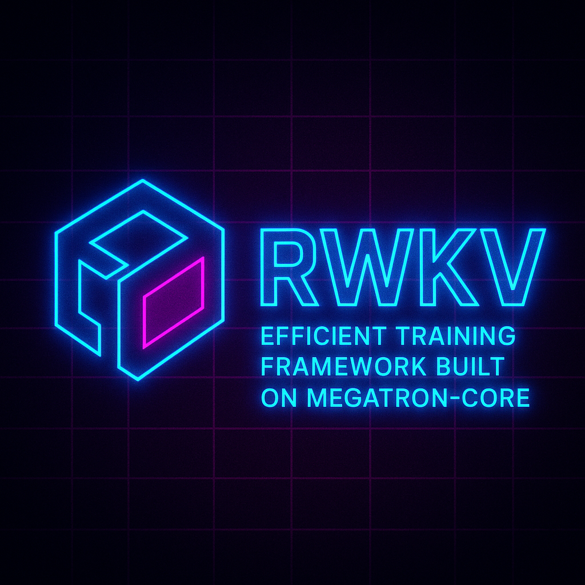

# RWKV-Megatron

<div align="center">



**基于Megatron-Core构建的RWKV架构大模型高效训练框架**

[](LICENSE)
[](https://www.python.org/downloads/)
</div>

## 📖 项目简介

RWKV-Megatron是基于NVIDIA Megatron-Core打造的高性能RWKV模型训练框架，专为大规模分布式训练而设计。本框架将RWKV的线性注意力机制与Megatron的高效并行训练技术相结合，实现了高效、高性能的大语言模型并行训练框架。

**RWKV模型优势**：
- 同时拥有RNN的高效推理和Transformer的并行训练能力
- 线性计算复杂度，降低内存消耗
- 优秀的上下文处理能力和长文本理解能力

**Megatron框架优势**：
- 完善的分布式训练架构
- 高效的模型并行和数据并行支持
- 丰富的GPU优化技术

## 🚀 核心特性

### 模型架构
- **原生支持RWKV6/7**：完整实现RWKV系列最新架构
- **模块化设计**：提供各类注意力机制、层规范化和嵌入方法的灵活组合
- **融合核心计算**：优化的WKV计算实现，提高训练和推理性能

### 分布式训练
- **全维度并行**：支持4D并行化策略
  - **张量并行** (Tensor Parallelism)：跨GPU分割模型层内结构
  - **流水线并行** (Pipeline Parallelism)：跨GPU分割模型层间结构
  - **序列并行** (Sequence Parallelism)：优化序列数据处理
  - **数据并行** (Data Parallelism)：横向扩展训练能力

### 性能优化
- **混合精度训练**：支持FP16和BF16混合精度训练
- **激活检查点**：智能管理内存使用，支持更大批量和序列长度
- **梯度累积**：高效实现大批量训练
- **CUDA融合算子**：优化的CUDA实现，最大化GPU利用率

### 互操作性
- **多种模型格式支持**：
  - 支持从RWKV-LM官方权重加载
  - 导出为PTH格式和HuggingFace格式 (coming soon)

## 💡 使用场景

- **超大规模预训练**：利用分布式训练进行万亿级参数模型训练
- **领域特化微调**：高效适应特定领域的知识
- **研究与创新**：为RWKV架构实验提供灵活基础
- **产业级应用**：稳定可靠的训练框架，支持产业级应用

## 🔧 快速开始

### 安装与环境配置

```bash
# 克隆仓库及子模块
git clone --recursive https://github.com/shiroko98/RWKV_Megatron.git
cd RWKV_Megatron

# 创建conda环境
conda env create -f environment.yml
conda activate rwkv-megatron
```
### 验证环境是否安装成功
你可以通过以下 Python 脚本测试 PyTorch 与 CUDA：
```bash
import torch
print("PyTorch version:", torch.__version__)
print("CUDA available:", torch.cuda.is_available())
```

### 使用方法

安装完成后，有几种可能的工作流程，包括：
1. 数据预处理
2. 预训练
3. 微调（对于零样本任务可选）
4. 下游任务评估或文本生成

### 一、数据预处理

```bash
from preprocess_data import process_data

process_data(
    input="/path/to/input/data/",             # 输入数据路径（文件或目录）
    output_prefix="./output/data",            # 输出文件前缀
    tokenizer_type="RWKVTokenizer",           # 分词器类型
    vocab_file="/path/to/vocab.txt",          # 词汇表文件
    workers=6,                                # 每个分区的工作进程数
    max_processes=24                          # 最大并发文件处理进程数
)
```
数据预处理脚本已优化并适配RWKV及其他模型，具体细节详见 [./data_processor/preprocess_data.py](./data_processor)

### 二、训练RWKV模型

### 配置YAML示例

使用YAML配置文件进行灵活的模型参数配置：

```bash
python pretrain_rwkv7.py --yaml-cfg config.yaml
```

### 分布式训练配置

可以根据您的硬件资源配置不同的并行策略：

```python
# 8-GPU张量并行
--tensor-model-parallel-size 8 --pipeline-model-parallel-size 1

# 2-GPU张量并行 × 4-GPU流水线并行
--tensor-model-parallel-size 2 --pipeline-model-parallel-size 4

# 启用序列并行
--sequence-parallel --tensor-model-parallel-size 8
```
### 编写启动脚本
编写以下脚本配置环境变量与配置文件：
```bash
#!/bin/bash
export TORCH_NCCL_AVOID_RECORD_STREAMS=1
export PYTORCH_CUDA_ALLOC_CONF=expandable_segments:True
export OMP_NUM_THREADS=24
export CUDA_DEVICE_MAX_CONNECTIONS=1

conda activate train_rwkv
cd /path/to/RWKV_Megatron

torchrun --master_port 51281 --nproc-per-node 8 --nnodes 1 pretrain_rwkv7.py --yaml-cfg config.yaml | tee output.log
```

## 如何贡献

我们欢迎各种形式的贡献，包括但不限于：

1. 报告问题和提出功能请求
2. 提交代码改进
3. 改进文档
4. 分享训练经验和优化技巧


## 📄 许可证

本项目采用 [LICENSE](LICENSE) 许可证开源。